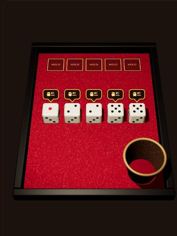
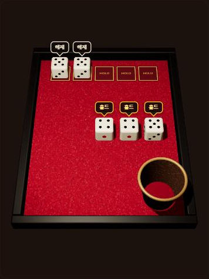
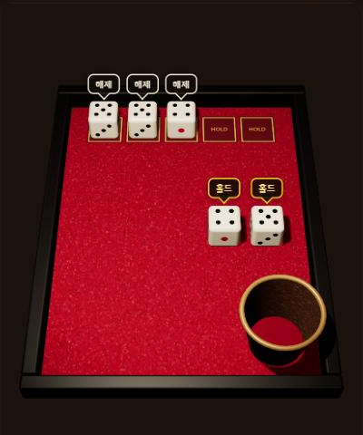

# 원작 조사: 「세계 게임전집 51」의 요트

> 조사일: 2026-10-12 ~ 2026-10-13. 요트 웹 게임 스펙(`docs/specs/yacht.md`)의 근거 자료다.
> 각 주장 뒤의 [A]~[L]은 맨 아래 **출처** 목록을 가리킨다. 확신도는 **높음**(1차 자료로 직접 확인), **중간**(2차 자료 여럿이 일치하거나 1차 자료 하나), **낮음**(추론)으로 적는다.

## 요약

「세계 게임전집 51」(닌텐도 스위치)의 요트가 전통 요트 규칙[H]과 다른 주요 점은 다음과 같다. 미국의 야찌(Yahtzee)와는 따로 비교하지 않았다(포 다이스 계산과 윗칸 보너스는 야찌에도 있는 규칙이라, 이 목록은 야찌와의 차이가 아니다).

- **포 다이스**는 같은 눈 4개만이 아니라 주사위 다섯 개를 모두 더한다.
- **S. 스트레이트**(4개 연속, 15점)가 따로 있다.
- 윗칸 합이 63점 이상이면 **보너스 35점**이 붙는다.
- 같은 눈 5개도 **풀 하우스**로 인정한다(확신도 중간, 2절 참고).

이 규칙으로 계산한 이론상 최대 점수는 325점이다.

화면 흐름은 공식 소개 영상으로 확인했다.

1. 주사위가 멈추면 판 가운데에 눈 오름차순으로 한 줄로 늘어선다.
2. 정렬이 끝나야 커서와 말풍선(일본판 「キープ」, 한국어판 표기는 확인 못 함)이 나타나고, 고른 주사위가 판 위쪽 홀드 자리로 올라간다.

동점 처리 방식과 터치 조작 장면은 찾지 못했다.

## 조사 방법과 한계

- 닌텐도코리아 공식 페이지의 한국어판 게임 화면 이미지[B]와 닌텐도 일본 공식 소개 영상[J]을 1차 자료로 삼았다. 영상은 재생 시점을 옮겨 가며 장면별로 확인했다.
- 점수 규칙은 공식 설명서를 직접 보지 못했다. 공식 페이지의 규칙 설명은 열리지 않았다(404). 그래서 나무위키[A]와 일본 플레이어 블로그 여러 곳[C][D][E][F]을 서로 맞춰 봤다.
- 터치 조작은 영문 공략[K]의 텍스트로만 확인했다. 장면 자료는 찾지 못했다.

## 1. 게임 기본 정보

| 항목 | 내용 | 확신도 | 출처 |
|---|---|---|---|
| 한국어판 제목 | 세계 게임전집 51 ("게임전집"을 붙여 씀). 「세계의 아소비 대전 51」은 일본판 제목 「世界のアソビ大全51」을 옮긴 비공식 이름이다(世界の는 번역, アソビ는 소리 옮김, 大全은 한자 읽기를 섞음). | 높음 | [B] |
| 한국 발매일 | 2020년 6월 5일 | 높음 | [B] |
| 인원 | 2인 대전, 또는 CPU 상대 | 중간 | 2인: [C][G], CPU: [E] |
| 턴 수 | 플레이어마다 12턴 | 중간 | [C] |
| 굴림 횟수 | 한 턴에 최대 3번. 원하는 주사위만 남기고 다시 굴린다. | 높음 | [A][C][J] |
| 동점 처리 | 찾지 못함. 모든 출처가 "합계가 높은 사람이 이긴다"고만 쓴다. | — | — |

## 2. 카테고리와 점수

| 카테고리 | 성립 조건 | 점수 | 확신도 | 출처 |
|---|---|---|---|---|
| 에이스~식스 | 언제나 | 해당 눈의 합 | 높음 | [A][C][D], 영상 [J] |
| 초이스 | 언제나 | 다섯 눈의 합 | 중간 | [A][C] |
| 포 다이스 | 같은 눈 **4개 이상**(5개 포함) | **다섯 눈 전체의 합** | 높음(같은 눈 4개) · 중간(같은 눈 5개) | [A][C][D][E], 영상 [J] |
| 풀 하우스 | 3개 + 2개 | 다섯 눈 전체의 합 | 중간 | [A][C][D][E] |
| S. 스트레이트 | 4개 이상 연속(1234·2345·3456) | 15 | 중간 | [A][C][D] |
| L. 스트레이트 | 5개 연속(12345·23456) | 30 | 중간 | [A][C] |
| 요트 | 같은 눈 5개 | 50 | 중간 | [A][C][D] |

점수 규칙은 공식 설명서를 보지 못해 2차 자료끼리 맞춰 본 것이라 대부분 확신도 **중간**이다. 에이스~식스와 포 다이스(같은 눈 4개인 경우)는 공식 영상[J]의 점수 미리보기로 직접 확인해 **높음**으로 올렸다: 1·1·1·1·3일 때 에이스 4, 포 다이스 7(다섯 눈 전체의 합)이 표시된다([36초](https://www.youtube.com/watch?v=mW6PK8AjHdY&t=36s)). 같은 눈 5개일 때 포 다이스가 성립하는지는 2차 자료로만 확인해 **중간**이다.

**윗칸 보너스** — 카테고리가 아니다. 기록하는 칸이 아니라 윗칸 여섯 카테고리의 합(소계)이 **63 이상**이면 자동으로 **+35**가 붙는다. 카테고리는 위 표의 12개뿐이고 턴도 12번이다. (확신도 중간, [A][C][G])

- **같은 눈 5개를 풀 하우스로 인정하는가 — 인정(확신도 중간).**
  - 직접 적은 출처는 [C] 하나다. 나머지 [D][E][G]는 "3개 + 2개"라고만 정의한다.
  - 다만 나무위키[A]가 적은 "풀 하우스 최대 30점"과 "이론 최대 325점"은 인정해야만 나오는 숫자라 서로 맞는다.
  - 게임기로 66666을 풀 하우스에 넣어 30점이 되는지 확인하면 확정할 수 있다.
- **보너스 기준은 "63 이상"이다.** 대부분 출처가 이렇게 쓰지만, [D]와 [E]는 "63점을 넘으면"이라고 쓴다. 63은 눈마다 3개씩 모은 값(3+6+…+18)이라 "이상"이 맞을 가능성이 높다.
- **요트 추가 보너스와 조커 규칙은 없다.** 이 게임에 대해 그런 규칙을 언급한 출처가 하나도 없다. 나무위키에 나오는 "요트 추가 70점"은 다른 게임(트릭컬 리바이브)의 규칙이다.
- **이론상 최대 점수는 325점이다.** 윗칸 105 + 보너스 35 + 초이스 30 + 포 다이스 30 + 풀 하우스 30 + S. 스트레이트 15 + L. 스트레이트 30 + 요트 50으로, [A]에 같은 계산이 있다.
- **기본 요트 규칙과 섞지 않는다.** 기본 규칙은 포 다이스가 같은 눈 4개만 더하고(최대 24점), 리틀 스트레이트(12345)와 빅 스트레이트(23456)가 각각 30점이다[A][H].

## 3. 한국어판 화면 표기

닌텐도코리아 공식 페이지의 [요트 게임 화면 이미지](https://www.nintendo.com/kr/switch/as7ta/img/games/game_img_yot.jpg)[B]에서 직접 읽었다. 원작 화면은 닌텐도 저작물이라 이 저장소에 복사하지 않고 링크로만 가리킨다. 띄어쓰기와 마침표까지 그대로 옮겼다(확신도 높음).

| 위치 | 표기 |
|---|---|
| 점수표 머리글 | 족보명 |
| 진행 표시 | 턴 4/12 (현재 턴/12) |
| 남은 굴림 | 앞으로 2번 |
| 윗칸 | 에이스 · 듀스 · 트레이 · 포 · 파이브 · 식스 |
| 윗칸 합계 줄 | 소계 ("0/63" 형태) |
| 보너스 줄 | 보너스+35 (붙여 씀) |
| 보너스 안내 | 1~6 눈 합계가 63점 이상이면 보너스 |
| 아랫칸 | 초이스 · 포 다이스 · 풀 하우스 · S. 스트레이트 · L. 스트레이트 · 요트 |
| 맨 아래 | 총합 득점 |

- 큰 스트레이트는 **"L. 스트레이트"**다. "B. 스트레이트"는 일본판 표기(B.ストレート)에서 온 것으로 보인다.
- 나무위키[A]는 "스몰 스트레이트 / 라지 스트레이트"로 풀어 쓰지만, 실제 화면은 줄임형 "S. / L."이다.
- 홀드 말풍선의 한국어 표기는 이미지에 나오지 않았다. 일본판은 「キープ」다. 한국어판은 "홀드"라는 사용자의 기억을 따랐다(확신도 낮음).

## 4. 한 턴의 화면 흐름

닌텐도 일본 공식 소개 영상[J]을 장면별로 확인했다. 아래의 "n초"는 이 영상의 재생 시점이고, 누르면 그 장면부터 재생된다.

### 4.1 굴리기 전
- **화면 배치**: 왼쪽에 점수표, 오른쪽에 위에서 내려다본 판이 있다. 판은 빨간 펠트 바닥에 검은 테두리이고, 위쪽 테두리에 빈 홈 다섯 칸(홀드 자리)이 있다([7초](https://www.youtube.com/watch?v=mW6PK8AjHdY&t=7s), [18.5초](https://www.youtube.com/watch?v=mW6PK8AjHdY&t=18s)).
- **컵**: 주사위 다섯 개가 담긴 가죽 컵(안쪽이 빨강)이 판 오른쪽 가장자리에 걸쳐 있다.
- **남은 굴림 표시**: 오른쪽 위에 「앞으로 N번」(일본판 「あと3回」)이 보인다.
- 확신도 높음.

### 4.2 던지기
- **연출**: 컵이 옆으로 누우면서 주사위를 판에 쏟는다([21초](https://www.youtube.com/watch?v=mW6PK8AjHdY&t=21s)). 확신도 높음.
- **조작** [K]: 확신도 중간.
  - 버튼: A로 컵을 흔들고 A로 굴린다.
  - 터치: 컵을 끌어서 흔들고 굴린다.
  - 휴대 모드: 본체를 흔들어 컵을 흔들 수 있다.

### 4.3 멈춘 뒤 자동 정렬
- **멈춘 직후**([22.8~23.2초](https://www.youtube.com/watch?v=mW6PK8AjHdY&t=22s)): 주사위가 흩어진 채 멈추고 컵이 빠진다. 남은 굴림이 하나 줄고, 점수표의 점수 미리보기가 바로 채워진다.
- **정렬**([23.4~24.5초](https://www.youtube.com/watch?v=mW6PK8AjHdY&t=23s)): 주사위가 떠올라 판 가운데에 가로 한 줄로 선다.
- **정렬 순서는 오름차순**이다. 떨어진 위치와는 상관없다. 확신도 높음.
  - 영상 [J]: 1,1,1,2,6 / 1,1,2,6 / 1,3
  - 블로그 [L]의 스크린샷 여러 장도 모두 오름차순이다.
- **양옆 안내**: 줄 양옆에 노란 화살표가 있다. 일본판 화면에서 왼쪽은 「役を選ぶ」(번역: 족보 고르기, 점수표로), 오른쪽은 「ふりなおす」(번역: 다시 굴리기, 컵을 가리킴)다[E][L]. 한국어판 표기는 확인하지 못했다(5절).

### 4.4 홀드
- **홀드는 정렬이 끝난 뒤에만 할 수 있다.** 커서와 말풍선은 줄이 다 선 다음에야 나타난다([22.8초](https://www.youtube.com/watch?v=mW6PK8AjHdY&t=22s) 흩어짐 → [24초](https://www.youtube.com/watch?v=mW6PK8AjHdY&t=24s) 줄 → [29.3초](https://www.youtube.com/watch?v=mW6PK8AjHdY&t=29s) 커서). 확신도 높음.
- **커서와 말풍선**: 줄의 주사위 하나에 노란 커서(모서리 괄호 모양)가 씌워지고, 그 위에 버튼 그림과 함께 「キープ」 말풍선이 뜬다([29.3초](https://www.youtube.com/watch?v=mW6PK8AjHdY&t=29s)). 버튼 그림은 A 버튼으로 보인다.
- **홀드하면** A를 눌러 그 주사위를 위쪽 홀드 자리로 올린다. 남은 주사위는 가운데로 다시 모인다([32.5초](https://www.youtube.com/watch?v=mW6PK8AjHdY&t=32s)).
- **홀드 표시**: 위치를 옮기는 것만으로 표시한다. 자물쇠 아이콘이나 강조 표시는 없다.
- **입력 방법** [K]: 방향키로 커서를 옮기고 A로 고르거나 푼다. 터치는 주사위를 탭한다(확신도 중간).
- **홀드 풀기**: 할 수 있다. 다만 텍스트로만 확인했고[E][K], 홀드 자리에서 줄로 돌아오는 장면은 보지 못했다.
- **홀드 자리 배치**: 매번 다시 정렬하지는 않는다. 예를 들어 3,4,2,1,6 순서로 놓인 장면이 있다[E]. 어느 칸에 들어가는지의 규칙은 확인하지 못했다.

### 4.5 다시 굴리기
- **누가 굴러가나**: 줄에 남은 주사위만 컵에 들어갔다 나온다. 홀드 자리의 주사위는 그대로다([33.4~34.5초](https://www.youtube.com/watch?v=mW6PK8AjHdY&t=33s)). 굴리는 동안 점수 미리보기는 사라진다.
- **다시 굴린 주사위의 정렬**: 자기들끼리만 가운데에 오름차순으로 다시 정렬되고, 홀드 자리 주사위와 섞이지 않는다([36.5초](https://www.youtube.com/watch?v=mW6PK8AjHdY&t=36s): 홀드 1,1,1 / 줄 1,3). 확신도 높음.
- **족보 이름 표시**: 굴림 결과가 족보가 되면 판 위에 그 이름이 크게 뜬다(예: 「포 다이스」)[L].

### 4.6 3번째 굴림 뒤와 기록
- **3번째 굴림 뒤**: 줄에 남은 주사위가 저절로 홀드 자리로 올라가 다섯 개가 모두 위에 모이고, 커서가 점수표로 넘어간다([58~59초](https://www.youtube.com/watch?v=mW6PK8AjHdY&t=58s)). 확신도 높음.
- **점수에 보태는 주사위 강조**: 커서가 가리키는 족보에 점수를 보태는 주사위만 노랗게 빛난다. 예를 들어 에이스면 1들만, S. 스트레이트면 1·2·3·4만 빛난다([60.5초](https://www.youtube.com/watch?v=mW6PK8AjHdY&t=60s), [E]). 확신도 높음.
- **기록**: 결정 버튼 한 번으로 기록되며, 확인창은 보이지 않았다([77.6→78.0초](https://www.youtube.com/watch?v=mW6PK8AjHdY&t=77s)). 편집된 영상이라 확신도는 중간이다.
- **3번째 전에도 기록 가능**: 왼쪽 화살표나 L 버튼으로 언제든 점수표로 갈 수 있다[K].

## 5. 확인하지 못한 것

- 동점일 때의 처리
- 66666을 풀 하우스에 넣었을 때 30점이 되는지 (게임기 확인 필요)
- 터치 조작 장면 (탭으로 홀드하기, 컵을 끄는 방향)
- 홀드를 풀 때의 애니메이션과, 홀드 자리 칸이 정해지는 규칙
- 한국어판의 「キープ」·「役を選ぶ」·「ふりなおす」·「決定」 표기
- 로컬 2인 대전에서 화면이 어떻게 달라지는지

## 6. 이 프로젝트가 원작과 다르게 정한 것

원작을 그대로 옮기지 않고 의도적으로 바꾼 부분이다. 결정과 그 이유는 스펙에 있다.

| 원작 | 이 프로젝트 | 이유 |
|---|---|---|
| 2인 대전 또는 CPU 상대 | 1~4인 핫시트. CPU 상대는 MVP에서 뺌 | 파티 게임 목적 |
| 홀드 자리를 다시 정렬하지 않음 | 굴림이 끝날 때 오름차순으로 다시 놓음 | 노리는 조합이 나란히 보이게 |
| 홀드할 때마다 남은 주사위를 가운데로 다시 모음 | 같은 열 안에서 위아래로만 옮기고, 다시 정렬은 굴림이 끝날 때만 함 | 터치로 연달아 탭할 때 누르려던 주사위가 움직이지 않게 |
| 커서와 「キープ」 말풍선 하나 | 탭할 수 있는 주사위마다 "홀드/해제" 말풍선 | 터치에는 커서가 없음 |
| 결정 버튼 한 번에 기록 | 카테고리 선택 → "기록" 버튼의 두 단계 | 터치에는 '가리키기'가 없어서 잘못 누르기 쉬움 |
| 동점 처리 불명 | 같은 순위 | 출처 없음 |

아래는 이 프로젝트의 시안(태그 `prototype-yacht-3d-look-v1`, [GitHub에서 보기](https://github.com/CaesiumY/party-games/blob/prototype-yacht-3d-look-v1/prototypes/yacht-3d-look/index.html), 카지노 펠트)을 휴대폰 크기 화면에서 캡처한 것이다. 원작 화면이 아니다. 원작의 같은 장면은 4절의 영상 링크로 볼 수 있다.

| 첫 굴림 뒤 | 다시 굴린 뒤 | 홀드 한 번 더 |
|---|---|---|
|  |  |  |
| 정렬 줄에 오름차순으로 늘어서고, 주사위마다 "홀드" 말풍선이 뜬다. 원작의 커서 + 「キープ」 말풍선([29초](https://www.youtube.com/watch?v=mW6PK8AjHdY&t=29s))을 터치용으로 옮겼다. | 5·5를 홀드하고 다시 굴린 뒤. 굴림이 끝날 때만 다시 정렬해, 홀드 자리는 왼쪽 열부터(5·5), 정렬 줄은 그 오른쪽 열부터(4·4·5) 놓인다. | 정렬 줄 왼쪽의 4를 홀드하자 같은 열의 홀드 자리로 곧게 올라갔고, 오른쪽 두 주사위는 제자리에 있다. 원작은 이때 남은 주사위를 가운데로 다시 모은다([32초](https://www.youtube.com/watch?v=mW6PK8AjHdY&t=32s)). |

시안의 홀드 자리 칸에는 "HOLD"라고 적혀 있지만, 스펙은 UI 한국어 원칙에 따라 "홀드"로 정했다.

## 출처

- [A] 나무위키 「요트(주사위)」, '세계 게임전집 51' 절 — https://namu.wiki/w/요트(주사위)
- [B] 닌텐도코리아 「세계 게임전집 51」 공식 페이지와 요트 화면 이미지 — https://www.nintendo.com/kr/switch/as7ta/ , https://www.nintendo.com/kr/switch/as7ta/img/games/game_img_yot.jpg
- [C] ぷりんの雑記帳 「【世界のアソビ大全51】ヨットを数学的に考える②」 — https://smooth-pudding.hatenablog.com/entry/2024/08/11/181557 (1편: https://smooth-pudding.hatenablog.com/entry/2024/08/10/122339)
- [D] note 「『世界のアソビ大全51』ヨット（ヤッツィー）の遊び方」 — https://note.com/tamanegitoonion/n/n48b8851f2ee9
- [E] 「【アソビ大全】運だけでは勝てない「ヨット」」 — https://okinotori.net/archives/485
- [F] note 月の石 — https://note.com/moonstone/n/n23fd520148ad
- [G] psmgp 「サイコロ「ヨット」のルール・遊び方」 — https://psmgp.com/yahtzee
- [H] 영어 위키백과 「Yacht (dice game)」 (기본 규칙 비교용) — https://en.wikipedia.org/wiki/Yacht_(dice_game)
- [I] 닌텐도 일본 공식 사이트 게임 목록 데이터(요트 소개 영상 ID가 들어 있음) — https://www.nintendo.com/jp/switch/as7ta/common/js/games_data.js
- [J] 닌텐도 일본 공식 「ヨット」 소개 영상 — https://www.youtube.com/watch?v=mW6PK8AjHdY
- [K] GameFAQs 공략 「Yacht Dice」 (CyricZ) — https://gamefaqs.gamespot.com/switch/286602-clubhouse-games-51-worldwide-classics/faqs/78437/yacht-dice
- [L] kimagure-azuma 플레이 기록(스크린샷) — https://kimagure-azuma.jp/asobi51-6/ , 그리고 amesss 블로그 — https://amesss.hatenablog.com/entry/2023/08/18/110721
